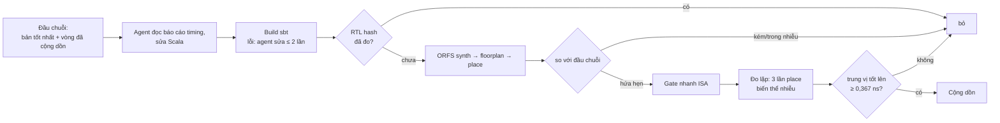

# Báo cáo: Tối ưu Fmax của SoC RISC-V trên sky130 bằng vòng lặp agent AI

*Project `soc-fmax-sky130` · nhánh `project/soc-fmax-sky130` · cập nhật 17/11/2026 (sau `m4-d`, `route-r8`, `route-r8b`; đang chờ `m4-e`)*

> Báo cáo này tóm tắt phương pháp và kết quả. Nhật ký kỹ thuật đầy đủ (lệnh chạy, lỗi đã gỡ, kiểm chứng bằng mock) nằm
> trong `README.md` cùng thư mục. Mọi số liệu ở đây đều **đo thật** trên máy người dùng, trừ chỗ ghi rõ là chưa chạy thật.

## 1. Tóm tắt

Project này đánh giá xem một agent AI (Claude Code) chạy trong vòng lặp tự động có tối ưu được tần số hoạt động tối đa
(Fmax) của một SoC RISC-V hoàn chỉnh hay không, khi chỉ được sửa RTL Chisel và bị ràng buộc chặt về chức năng, hiệu
năng chu kỳ và diện tích. Thiết kế là `chipyard.MinimalSoCConfig` (1 nhân Rocket có FPU, L2 128 KiB, bus, uncore), tổng
hợp trên PDK mã nguồn mở SkyWater **sky130hd** bằng OpenROAD-flow-scripts (ORFS); Fmax đo sau bước place.

Sau 3 đợt loop (15 vòng agent, khoảng 6,3 giờ máy), Fmax sau place tăng từ **65,42 MHz lên 101,98 MHz (+55,9 %)**, đạt
bậc ràng buộc 10 ns (WNS +0,194 ns). Thiết kế vẫn đúng chức năng (riscv-tests, 8 benchmark, so vết commit từng lệnh), số
chu kỳ không đổi (tỉ lệ 1,0000) và diện tích logic chỉ tăng 2,3 %. Kiểm tra độc lập sau CTS (cây clock thật) cho
100,66 MHz, vẫn đạt 10 ns. Ở bậc 9 ns, độ dao động của place (±1,5 ns trên cùng một RTL) lớn hơn mọi cải thiện của một
vòng. Vì vậy luật nhận được sửa thành **đo lặp** (so trung vị 4 lần place). Đợt đầu theo luật mới nhận một thay đổi:
trung vị place ở 9 ns lên **103,64 MHz** (chu kỳ đạt được 9,649 ns, +58 % so với baseline), chưa đạt bậc 9 ns.

## 2. Bối cảnh và mục tiêu

- **Bài toán.** Nâng Fmax thường cần chia lại pipeline, retiming hoặc viết lại logic điều khiển trên đường găng. Đây là
  việc tốn công, đòi hỏi hiểu cả RTL lẫn báo cáo timing. Câu hỏi đặt ra: một agent LLM, được cấp báo cáo timing và mã
  nguồn, có tự đề xuất được những thay đổi đúng và có lợi không, nếu có một hệ thống đo và luật nhận khách quan bao quanh?
- **Khung thực nghiệm.** [CHIA](https://github.com/ucb-bar/chia) (UC Berkeley) là framework co-design dùng agent AI,
  chạy trên Ray và Docker. Mỗi công cụ (Chipyard/sbt, Verilator, ORFS, Claude Code) chạy trong một container riêng
  ("khối"), trên một máy 20 CPU, 23 GB RAM.
- **Mục tiêu.** Đi theo các bậc chu kỳ ràng buộc 10 → 9 → 8 → 7 → 6 → 5 ns. Đích cuối là 200 MHz (5 ns) có route và GDS.
- **Ràng buộc** (so với `MinimalSoCConfig` gốc): đúng chức năng; chi phí chu kỳ (trung bình nhân `mcycle`) ≤ +3 %;
  diện tích logic (không tính SRAM) ≤ +15 %.

## 3. Thiết lập thực nghiệm

| Hạng mục | Lựa chọn |
|---|---|
| Thiết kế | `DigitalTop` của `MinimalSoCConfig`, Chipyard 1.15.0, 380 module, 10 macro SRAM |
| PDK, corner | sky130hd (`sky130_fd_sc_hd`), `tt_025C_1v80` |
| SRAM | fakeram sinh bằng script (truy cập 1,5 ns, 3 µm²/bit; timing giả định) |
| Công cụ | Yosys + OpenROAD (ORFS): synth phân cấp → floorplan → place; CTS/route để hiệu chỉnh |
| Đo Fmax | 1000 / (T − WNS) sau place. Không tính đường chạm cổng I/O và reset bất đồng bộ. Miền clock JTAG/serial-TL khai bất đồng bộ |
| Kiểm chức năng | riscv-tests `rv64u{i,m,a,f,d}-p-*` (106/107, 1 test hỏng sẵn ở baseline), 8 benchmark (`minstret` phải bằng baseline), `func_check` |
| Agent | Claude Code (Opus, effort medium, tối đa 30 phút/phiên), chỉ sửa bản chép của mã nguồn Scala |

Thuật ngữ:
- **Chu kỳ đạt được** = T − WNS = 1000/Fmax. Luật nhận so sánh trên đại lượng này chứ không trên MHz, vì cùng một mức
  dao động tính bằng ns sẽ thành số MHz lớn hơn khi Fmax cao.
- **Điểm họ**: tổng slack của các họ endpoint xấu nhất. Đại lượng này phản ánh việc sửa nhiều đường cùng lúc, kể cả khi
  WNS không đổi.

**Baseline** (place ở 10 ns): **65,42 MHz**, WNS −5,285 ns, đường găng trong bộ nhân-cộng số thực kép (`dfma`) của
FPU; L2 có 6 120 endpoint âm; diện tích logic 2,233 mm².

## 4. Phương pháp: vòng lặp agent

### 4.1. Một vòng

1. **Agent.** Agent nhận báo cáo place của bản tốt nhất và các vòng trước (đường găng, slack theo vùng, họ endpoint),
   lịch sử thử và các lỗi build. Agent sửa trên bản chép của mã nguồn, chỉ đọc chứ không tự build được. Patch là phần
   diff của bản chép đó.
2. **Không đo trùng.** RTL được băm (bỏ chú thích vị trí nguồn). Hash có trong khoá cache và tên variant ORFS, nên một
   RTL không bao giờ bị đo lại, và mọi bước đã chạy đều được dùng lại từ cache.
3. **Đo bằng place.** Mỗi vòng đi tới bước place. Synth (khoảng 52 MHz ở mọi vòng) và floorplan (bão hoà quanh
   100 MHz vì bước sửa timing dừng khi slack ≥ 0) không phân biệt được các vòng, nên chỉ ghi để tham khảo (mục 6.1).
4. **Cộng dồn trong đợt.** Vòng được nhận tạm sẽ thành nền cho vòng sau. Cuối đợt, các bản cộng dồn được kiểm đầy đủ
   (gate + `func_check` + ngân sách chu kỳ) theo thứ tự Fmax giảm dần. Bản đầu tiên qua được nhận; nếu hỏng thì lùi về
   bản trước.
5. **Bậc chu kỳ.** Khi bản nhận có WNS ≥ 0, job tự xuống bậc kế, đo lại bản tốt nhất và đo nhiễu ở bậc mới.

### 4.2. Kiểm chức năng bằng vết commit (`func_check`)

Riêng gate (kết quả benchmark đúng) không bắt được lỗi khi cùng một kết quả được tính qua một chuỗi lệnh sai. Vì vậy
`func_check` so **vết commit của Rocket từng lệnh** (pc, mã lệnh, giá trị ghi thanh ghi) giữa ứng viên và baseline trên
4 benchmark. Thay đổi pipeline hợp lệ có thể làm lệch số chu kỳ, nên mọi giá trị đọc từ bộ đếm (`mcycle`, `minstret`…)
được đánh dấu "nhiễm" (taint). Taint lan qua thanh ghi và địa chỉ bộ nhớ; gặp nhánh phụ thuộc giá trị nhiễm thì dừng
so. Baseline so với chính nó ở seed khác phải đạt. Bước này đã được kiểm như vậy.

### 4.3. Luật nhận và nhiễu đo

Place của ORFS là tất định, nhưng rất nhạy với thay đổi nhỏ của netlist. Ngưỡng nhiễu được đo bằng cách chạy lại một
bản với các biến thể tham số place (`PLACE_DENSITY` ±0,01, `CORE_UTILIZATION` +1) và lấy 1,5 × khoảng dao động:

| Điểm đo | Dao động chu kỳ đạt được | Ngưỡng |
|---|---|---|
| Baseline @ 10 ns (4 biến thể) | 0,245 ns | ±0,367 ns (±1,546 MHz) |
| Bản tốt nhất r8 @ 9 ns | 1,517 ns (90,7 – 105,1 MHz) | ±2,275 ns |

Luật nhận thay đổi theo kết quả thực nghiệm. Các phương án đều do người hướng dẫn duyệt:

| Phiên bản | Luật | Lý do đổi |
|---|---|---|
| `m4-a` | Lọc vòng bằng floorplan, chỉ place cuối đợt | Floorplan bão hoà ~100 MHz, không phân biệt được vòng |
| `m4-b`, `m4-c` (hướng B) | Mỗi vòng tới place, một lần đo, ngưỡng ±0,367 ns | Ở 9 ns nhiễu ±2,275 ns chặn mọi vòng |
| `m4-d` (phương án A) | Một lần place để lọc; vòng hứa hẹn được place thêm 3 lần; nhận khi **trung vị 4 lần** tốt lên ≥ 0,367 ns | `m4-d`: nhận r16, chặn 2 vòng có một lần đo tốt nhưng trung vị dưới ngưỡng |

Phương án A tách hai câu hỏi: "vòng có đáng đo kỹ không" (một lần đo, rẻ) và "vòng có thực sự tốt hơn không" (trung vị,
bền với nhiễu). Mỗi vòng hứa hẹn tốn thêm khoảng 45 phút. Ở `m4-d`, 4 lần place của cùng một RTL vẫn dao động
0,46–0,87 ns, và đo lặp chiếm khoảng một nửa thời gian máy của đợt.

## 5. Kết quả

### 5.1. Tiến trình Fmax

| Mốc | Thay đổi được nhận | Fmax place | WNS (ns) | Logic | Cycle |
|---|---|---|---|---|---|
| Baseline | — | 65,42 MHz | −5,285 @ 10 ns | 2,233 mm² | 1,0000 |
| `m4-a` (5 vòng, 1,5 giờ) | r1 + r2 + r5 | 86,86 MHz (+33 %) | −1,513 | +2,5 % | 1,0000 |
| `m4-b` (5 vòng, 2,1 giờ) | + r6, r7, r8 | **101,98 MHz (+55,9 %)** | **+0,194 → đạt 10 ns** | +2,3 % | 1,0000 |
| `m4-c` (5 vòng, 2,7 giờ) | không nhận (trong nhiễu) | r8 @ 9 ns: 96,26 (trung vị 98,96) | −1,389 @ 9 ns | | |
| `m4-d` (5 vòng, 4,5 giờ, đo lặp) | + r16 | trung vị **103,64 MHz** @ 9 ns (+58 %) | −0,817 @ 9 ns (1 lần đo) | +6,6 % | 1,0000 |

Các thay đổi agent đề xuất và được nhận:

| Vòng | Khối | Kỹ thuật |
|---|---|---|
| r1 | FPU `dfma` | Retiming: dời thanh ghi thừa sau khâu làm tròn lên giữa preMul và bộ nhân, giữ latency 4 |
| r2 | Bus, L2 | Hàng đợi flow depth 1 → `flowQueue1`; putbuffer L2 ghi sớm |
| r5 | Bus, L2 | Gộp `eagerQueue` cho TLBuffer, cổng `peek` của `ListBuffer` theo MSHR, `ToAXI4` dùng `flowQueue1Irrevocable` |
| r6 | FPU `sfma` | Đăng ký riêng A·B và C, dời phép cộng C sang tầng postMul |
| r7 | Core `IBuf` | Tách Shannon `inst0_valid` theo `imem.valid` trên đường `mem_wrong_npc` |
| r8 | L2 `SourceD` | Tách Shannon theo `bs_wadr.ready` cho khối bypass |
| r16 | L2 `ListBuffer`, FPU `dfma` | Thanh ghi giữ tag đầu mỗi hàng đợi (bỏ chuỗi đọc Mem nối tiếp); tích con A×B ở tầng preMul, cây CSA 3:2 viết tay |

Đường găng dịch chuyển qua các vòng: `dfma` → `sfma` → `ifpu`/L2. Agent đã tìm đúng nút thắt kế tiếp sau mỗi lần sửa.
Nó cũng biết gộp hai thay đổi nhỏ (r5) khi từng thay đổi riêng lẻ nằm trong nhiễu.

Các vòng bị loại cũng cho thông tin. Ở 9 ns, ba cách sửa L2 khác nhau (r11, r13, r15) đều đưa đường găng sang `dfma`
và giảm TNS từ khoảng −1 316 xuống −6..−118 ns, tức là có tác dụng thật. Nhưng cải thiện một lần đo (+0,75 ns) vẫn nhỏ
hơn ngưỡng ±2,275 ns. r12 bị loại vì diện tích vượt 1,15×. Ở `m4-d`, agent gộp cách sửa L2 tốt nhất (r15) với sửa
`dfma` thành r16 và vượt ngưỡng trung vị (+0,456 ns). Hai vòng r17, r19 có một lần đo tốt hơn +0,30..0,39 ns nhưng trung
vị chỉ +0,13..0,16 ns, nên bị chặn đúng như luật đo lặp dự kiến. Floorplan đã đạt 9 ns từ r17 (bão hoà lần nữa);
khoảng cách còn lại khoảng 0,5 ns nằm ở place.

Chi phí: mỗi vòng 19–25 phút (agent 2–5 phút, synth 4, floorplan 1–2, place 9,5). RAM đỉnh 9,5 GB, ở bước build.

### 5.2. Độ tin của Fmax sau place

Place dùng clock lý tưởng và RC ước lượng. Để kiểm chứng, bản r8 ở 10 ns được đưa qua CTS và route (`route_check.py`):

| Bước | Fmax | WNS | Logic | Đường găng |
|---|---|---|---|---|
| Place | 101,98 MHz | +0,194 | 2,284 mm² | FPU `ifpu` |
| CTS (clock propagated) | **100,66 MHz** | **+0,065** | 2,428 mm² (+6,3 %) | FPU `dfma` |
| Global route | lỗi GRT-0116 (nghẽn) | | | |

Sau CTS, chu kỳ đạt được chỉ chậm hơn place **0,129 ns**, nhỏ hơn ngưỡng nhiễu, nên bậc 10 ns vẫn giữ. Điều này cho
thấy Fmax place là đại lượng chọn lọc chấp nhận được ít nhất ở bậc này.

Global route thất bại dù chỉ dùng 22 % tài nguyên dây: tràn cục bộ ở met1/met2 (tổng 38 557). 99 % ô tràn thuộc net
của L2 `bankedStore`, dồn ở góc trên trái die, có thể quanh 4 macro `cc_banks`. Đây là vấn đề floorplan và chân
fakeram, không phải timing. Lần chạy lại với cờ `-allow_congestion` (cho global route đi tiếp dù tràn) xác nhận điều này:
tràn vẫn y hệt (38 557), và detailed route sau khoảng 7 giờ, 12 vòng tối ưu vẫn còn **12 705 vi phạm DRC** (từ 400 027;
từ vòng 5 mỗi vòng chỉ giảm 2–8 %), nên được dừng tay. Vì vậy chưa có Fmax sau route; số đáng tin nhất hiện có là sau CTS. Báo cáo DRC trung gian cho thấy vi phạm
còn lại chủ yếu là chập dây trên **met4/met5** (12 091/12 605) giữa net `bankedStore` và lưới nguồn `VDD`/`VSS`, cùng vùng
nghẽn: dây bị đẩy lên lớp trên đụng dải PDN quanh macro. Đây là việc của floorplan/PDN (M5); việc đo sau route được tạm
ngưng, loop tiếp tục tối ưu theo place.

## 6. Thảo luận

1. **Bão hoà của bước đo trung gian.** Floorplan và place đều có bước sửa timing dừng khi slack ≥ 0. Khi thiết kế đã gần
   đạt ràng buộc, mọi họ đường đều sát 0 và thước đo mất khả năng phân biệt. Thước đo chọn lọc vì vậy phải là bước có
   khoảng cách đủ lớn tới ràng buộc. Đây là lý do chuyển từ floorplan sang place, và là lý do xuống bậc khi đạt.
2. **Nhiễu do đổi netlist lớn hơn nhiễu đo trên baseline.** r9, r10 kém r8 0,36–0,68 ns ở những vùng không bị sửa. Ở
   bậc chặt hơn (9 ns), cùng một RTL dao động 1,5 ns chỉ vì đổi mật độ place. Một lần đo không đủ để kết luận cải thiện
   dưới khoảng 1 ns. Đây là giới hạn của bước đo, không phải của agent.
3. **Agent và thước đo.** Agent cho thay đổi có ý nghĩa ở hầu hết các vòng: 6/10 vòng của `m4-a`/`m4-b` được cộng dồn,
   không vòng nào làm hỏng chức năng ở gate cuối đợt. Từ bậc 9 ns, giới hạn chính chuyển sang độ phân giải của phép đo.
   Vì vậy phương án A đổi thời gian máy lấy độ tin cậy, thay vì nới ngưỡng và chấp nhận nhận nhầm.

## 7. Hạn chế

- **fakeram.** Timing (1,5 ns) và chân SRAM là giả định. Kết quả L2, và có thể cả nghẽn route, sẽ khác với OpenRAM
  thật (M6).
- **Một corner** (`tt`). Không có phân tích đa corner hay IR drop.
- **Fmax chính thức hiện là số sau place** (đã hiệu chỉnh với CTS ở 10 ns). Chưa có số sau route.
- **`func_check` chỉ phủ một phần.** `mm` chỉ được so khoảng 17 % (dừng ở nhánh phụ thuộc bộ đếm). Thay đổi làm lệch số
  chu kỳ trước vùng đo bị báo hỏng nhầm, vì taint không theo giá trị bộ đếm qua bộ nhớ (gặp ở M3 với một patch
  `Queue`).
- **Mỗi vòng chỉ có một mẫu agent** (một phiên, một đề xuất). Chưa đánh giá độ biến thiên giữa các lần chạy agent.

## 8. Việc tiếp theo

| Việc | Trạng thái |
|---|---|
| `m4-d`: luật đo lặp ở 9 ns | xong: nhận r16, 103,64 MHz (trung vị), chưa đạt 9 ns |
| `m4-e`: đi tiếp từ `m4-d` | chờ chạy |
| `route-r8b`: route với `-allow_congestion` | dừng sau ~7 giờ, còn 12 705 vi phạm DRC: cần sửa floorplan trước |
| Xử lý nghẽn quanh `cc_banks` (halo/kênh macro, chân fakeram, `CORE_UTILIZATION`) | đề xuất cho M5 |
| Tiếp tục bậc 8 → 5 ns | M4 |
| M5: CTS + route + GDS cho mọi bậc đã đạt | sau khi đạt 5 ns |
| M6: OpenRAM sky130 thật, so với fakeram | chưa |

## Phụ lục: nguồn số liệu

| Số liệu | Lấy từ |
|---|---|
| Baseline, nhiễu 10 ns | `~/soc-fmax-runs/m1`, `m2-noise` (`noise.json`) |
| Các vòng loop | `~/soc-fmax-runs/m4-a`, `m4-b`, `m4-c`, `m4-d` (`history.md`, `results.csv`, `summary.md`) |
| CTS/route | `~/soc-fmax-runs/route-r8/summary.md`, `route-r8b` (log `5_1_grt.log`, `5_2_route.log`), `orfs/congestion_summary.py` |
| Patch được nhận | `~/soc-fmax-runs/m4-d/best.patch` (RTL hash `f0f3ab6946f1`; bản đạt 10 ns: `m4-b`, `2370465e8eb7`) |
